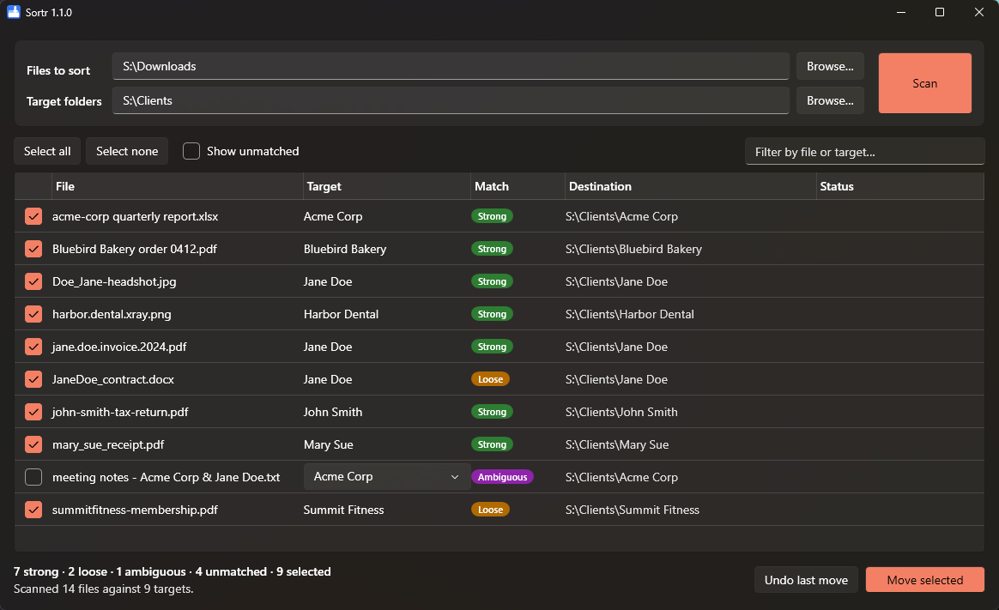
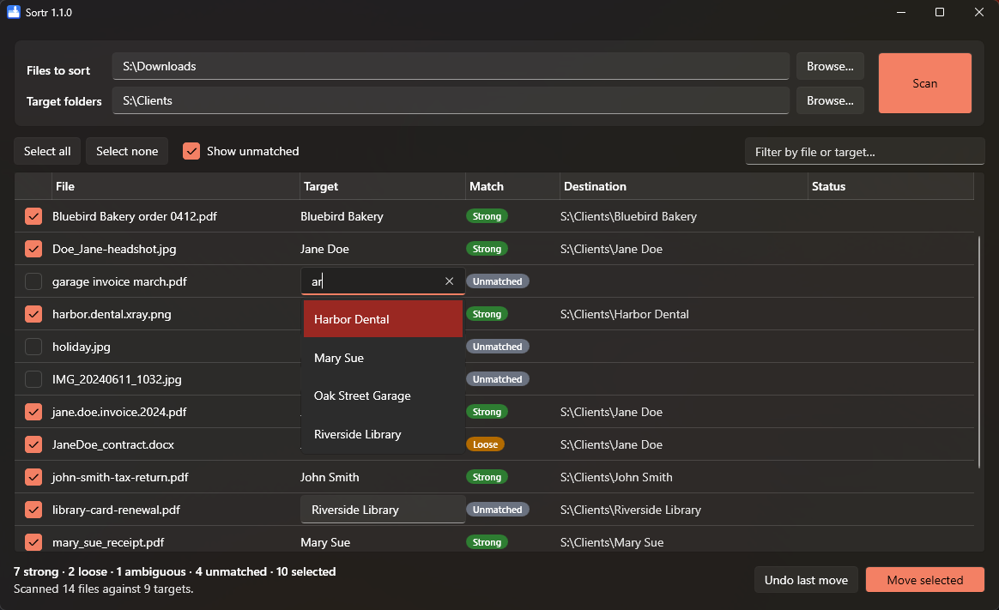

# Sortr

**Sortr moves files into the right folders by reading their names.**

**[⬇ Download Sortr.exe](https://github.com/chucklingkoala/sortr/releases/latest)**: a single file of about 3.5 MB with nothing to install. It runs on 64-bit Windows 10/11.

You have a folder full of loose files whose names mention who or what they belong to:

```
Downloads\
  jane.doe.invoice.2024.pdf
  JaneDoe_contract.docx
  Doe_Jane-headshot.jpg
  acme-corp quarterly report.xlsx
  meeting notes - Acme Corp & Jane Doe.txt
  holiday.jpg
```

You also have a folder with one subfolder per person, client, project or other category. Sortr calls these **targets**:

```
Clients\
  Acme Corp\
  Jane Doe\
  Mary Sue\
```

Sortr reads every file name, works out which target it mentions, and shows you a list to check. When you're happy, one click moves each file into its target's folder:

```
Clients\
  Acme Corp\  acme-corp quarterly report.xlsx
  Jane Doe\   jane.doe.invoice.2024.pdf, JaneDoe_contract.docx, Doe_Jane-headshot.jpg
```

Files that mention no target stay where they are. For `holiday.jpg` that's because no target matched. `meeting notes - Acme Corp & Jane Doe.txt` mentions two targets, so it's left for you to decide.

It works with any file type: documents, photos, videos, music and so on. Only the file name matters.



## Using it

1. **Files to sort**: pick the folder of files to sort. Only files directly in that folder are scanned, not its subfolders.
2. **Target folders**: pick the folder that contains one subfolder per target. Each subfolder's name is the name Sortr searches for.
3. Click **Scan**. Every file is listed with the target it matched and a badge showing how confident the match is.
4. Review the list. Untick anything that's wrong, and pick a target for any file marked *Ambiguous*.
5. Optionally, tick **Show unmatched** to sort the files Sortr couldn't place. Type part of a target's name in the file's Target box, then pick the target from the filtered list. Unmatched files stay hidden until you tick the box, so they don't clutter the main list.
6. Click **Move selected**. If you change your mind, **Undo last move** puts that batch back where it came from.



The search ignores capitalisation, accents and separators, so `riverside`, `side lib` and `riversidelibrary` all find **Riverside Library**. Names that start with what you typed are listed first.

The app follows Windows' light/dark setting and accent colour. The version number is shown in the window title.

## How names are matched

File names are messy, so Sortr ignores capitalisation, accents and separators (`.`, `_`, `-`, spaces, brackets…). It also accepts the name in reverse order. With a target called **Jane Doe**:

| Badge | Meaning | Example file names | Ticked by default? |
|---|---|---|---|
| **Strong** | The name appears as separate words | `jane.doe.invoice.pdf`, `Doe_Jane.jpg`, `Jane Doe (2024).docx` | Yes |
| **Loose** | The name appears run together | `JaneDoe_contract.docx`, `janedoe.png` | Yes; worth a glance |
| **Ambiguous** | More than one target matched | `Jane Doe and Mary Sue.txt` | No; choose the target from the dropdown |
| **Unmatched** | No target matched | `holiday.jpg` | No; hidden unless *Show unmatched* is ticked, then type to pick a target |

Some rules reduce false matches:
- **One-word targets** (e.g. "Nova") must appear as a separate word. `nova_logo.png` matches, but `casanova.pdf` doesn't.
- **Short names** (two words, fewer than 6 letters in total, e.g. "Ann Li") must appear as separate words. Otherwise "annli" would match inside unrelated text like `joannlivestream`.
- **Longer names win.** If you have both "Jane Doe" and "Jane Doe Smith", then `jane.doe.smith.pdf` goes to "Jane Doe Smith".

## Review shortcuts

- **Space** ticks or unticks all highlighted rows.
- **P** opens a preview of the highlighted file in a separate window (also on the right-click menu). While it's open, **↑/↓** steps through the list and the preview follows. Press **P** or **Esc** to close it.
- **Double-click** a row to open the file.
- Right-click a row for **Show in Explorer**.
- Choosing a target from an ambiguous row's dropdown ticks that row.
- In an unmatched row's search box: type to filter the targets, use **↑/↓** to move through the list, press **Enter** or click to pick, and press **Esc** to cancel. Picking a target ticks the row. Clearing the box and pressing **Enter** removes the target.

### What the preview shows

| File | Preview |
|---|---|
| Images (JPG, PNG, GIF, BMP, TIFF, ICO, WebP; HEIC and JPEG XR if Windows has the codec) | The picture, upright even if a phone saved it sideways. Animated GIFs play. |
| Video and audio (MP4, MOV, WebM, MP3, WAV, FLAC, …) | A player with play/pause, seek and mute. Videos start playing muted; audio waits for **Play**. Formats are the ones Microsoft Edge can play; anything else (such as WMV and AVI) falls back to the thumbnail. |
| Text (TXT, MD, LOG, CSV, JSON, XML, code, and files with no extension that contain text) | The first 256 KB. |
| Anything else (PDF, Office, archives, …) | The thumbnail or icon Explorer would show. Click **Open** to view it in its default app. |

The preview never stops a file from being moved: a playing video is stopped before **Move selected** or **Undo** starts.

## Safety

- **Nothing is overwritten.** If the target folder already has a file with the same name, the moved file is saved as `name (1).ext`.
- **Every move is logged** as it happens, to `%LocalAppData%\Sortr\undo\`. Undo works even if the app closed mid-move.
- **Undo is careful.** It only moves a file back if its original spot is still free. Anything it can't restore stays in the log, so you can retry.
- You confirm before anything moves.

## Building

Requires [Rust](https://rustup.rs/) (stable). There is no Node.js or other front-end toolchain: the UI in `ui/` is plain HTML, CSS and JavaScript, embedded into the exe as it is.

```
cargo test --workspace
cargo run -p sortr
```

A debug build (`cargo run`) also opens a console window for log output.

### Single executable

```
cargo build --release
```

This produces `target/release/Sortr.exe`, a single file of about 3.5 MB. It runs on any 64-bit Windows 10/11 PC. Settings that keep it small are in the root [Cargo.toml](Cargo.toml): optimise for size, link-time optimisation, no unwinding, no symbols.

The UI runs in Microsoft Edge WebView2, which comes with Windows 11 and updated Windows 10. It isn't bundled into the exe. If it's missing, Sortr shows a message with the download link instead of starting.

The exe isn't code-signed, so Windows SmartScreen may warn on first run. Click *More info → Run anyway*.

### Releasing

Push a version tag. GitHub Actions then runs the tests, builds `Sortr.exe` and publishes it as a GitHub Release, along with a SHA-256 checksum:

```
git tag v2.0.0
git push origin v2.0.0
```

The tag sets the version number stamped into the exe. The workflow is in [.github/workflows/release.yml](.github/workflows/release.yml).

### App icon

The icon is drawn in code by `tools/IconGen`. After editing it, regenerate the icon with this command. The optional second argument writes a preview sheet.

```
dotnet run --project tools/IconGen -- src/Sortr.App/Assets [preview.png]
```

## Project layout

- `crates/sortr-core`: the matching, scanning, moving, undo and settings logic (no UI), with its tests.
- `src-tauri`: the Windows app (Tauri 2): the commands the UI calls, the preview window, and the native pieces (folder picker, message boxes, shell thumbnails, image decoding with Windows' codecs).
- `ui`: the main and preview windows' HTML, CSS and JavaScript.
- `tools/IconGen`: the icon generator (.NET; only needed to redraw the icon).
- `src`, `tests`: the Sortr 1.x .NET app, kept until the Rust version is verified.

## License

[MIT](LICENSE)
